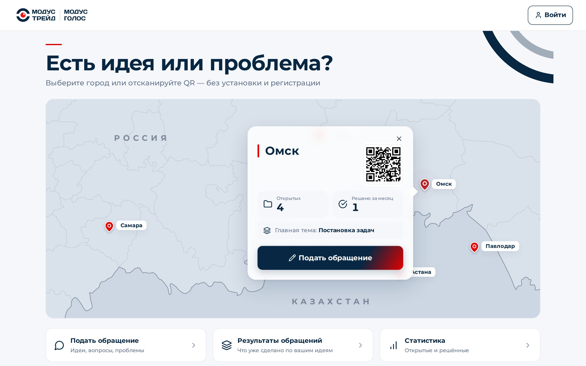

# «Модус Голос» — каждый голос услышан

Система обратной связи сотрудников ГК «Модус Трейд»: проблема или идея с телефона по QR — без установки и регистрации.
Обращение сразу попадает к ответственному, автор видит статус и результат, руководство — повторяющиеся темы и лигу филиалов.
Режим совещания превращает запись планёрки в поручения, решения и идеи директору; «Директор в кармане» — главное на телефоне.



**Живое демо: https://modus.cq-systems.kz** — данные синтетические, имена вымышленные.

**Демо-вход без паролей:** `/login` → «Войти как…»

| Кто | Роль | Что смотреть |
|---|---|---|
| Сергей Михайлович | директор | `/panel#/summary` — сводка, карта, «На решение», команды голосом; `/boss` — «Директор в кармане» на телефоне |
| Олег Савельев | ответственный (руководитель направления) | `/panel` — очередь обращений; `/app#/meeting` — режим совещания |
| Ольга Миронова | сотрудник | `/app` — «Есть идея или проблема?», мои обращения, баллы, лига |
| Игорь Лебедев | администратор | `/panel#/admin` — сотрудники, категории, награды, настройки, QR-плакаты |
| без входа | любой сотрудник | `/q/PVL` — QR-форма филиала (Павлодар); `/changes` — «Результаты обращений» |

На живом демо демо-входу закрыты опасные действия администратора (сброс демо, импорт и правка сотрудников, приглашения, Битрикс24) —
они доступны только с компьютера, где запущен сервер (`http://localhost:…`). Подробно — [docs/SECURITY.md](docs/SECURITY.md).

## Запуск одной командой (Docker)

Нужен Docker: на Windows и Mac — [Docker Desktop](https://www.docker.com/products/docker-desktop/), на Linux — Docker Engine с плагином compose.
В папке проекта:

```bash
docker compose up --build
```

Через 1–3 минуты (первая сборка) откройте **http://localhost:8090**. Демо-база поднимается сама при первом запуске — те же
обращения, совещание и сводка, что на живом демо, даты сдвинуты на «сегодня». Остановить — `Ctrl+C`; начать с чистой демо-базы —
`docker compose down -v` и снова `docker compose up --build`. Порт меняется переменной `MF_PORT` в `.env`.

## Без Docker

Нужен **Python 3.11 или новее** ([python.org](https://www.python.org/downloads/); на Windows при установке отметить «Add python.exe to PATH»).
Скрипт создаёт окружение `.venv`, ставит зависимости, поднимает демо-базу и сервер на **http://localhost:8090**:

- **Windows** (PowerShell): `powershell -ExecutionPolicy Bypass -File .\run.ps1`
- **Linux / macOS**: `./run.sh`

## Ключи

- **Без ключа OpenAI всё работает в демо-режиме:** категория обращения — по словарю ключевых слов, сводка директора — шаблоном из тех же
  чисел, разбор планёрки — заскриптованный демо-разбор. Что делает ИИ и что без него — сказано в подсказках «?» рядом с блоками.
- **С ключом:** скопируйте `.env.example` в `.env` и впишите `OPENAI_API_KEY=…` (файл `.env` в git не попадает), перезапустите сервер.
- **Расшифровка голоса:** без видеокарты — через OpenAI (`MF_STT=openai`, нужен ключ; в `run.sh`/`run.ps1` выставлено по умолчанию).
  На машине с видеокартой NVIDIA — локально: `pip install -r requirements-stt.txt` и `MF_STT=faster-whisper`. Без ключа и без видеокарты
  планёрку можно вставить текстом.

## Что посмотреть за 5 минут

- [docs/DEMO.md](docs/DEMO.md) — сценарий показа: шесть болей собственника и как система их закрывает, по шагам.
- [docs/CONCEPT.md](docs/CONCEPT.md) — концепция, роли, стадии и статусы обращения.
- [docs/SECURITY.md](docs/SECURITY.md) — аудит безопасности и что исправлено.
- [docs/PROCESS.md](docs/PROCESS.md) — как шла работа: кастдев, этапы, решения.
- [docs/tz/](docs/tz/README.md) — ТЗ по этапам; [docs/STATUS.md](docs/STATUS.md) — что реализовано, что имитация, план.
- Скрины: [docs/screens/](docs/screens/) (телефон 375 px и компьютер 1440 px), слайды — [demo/slides/](demo/slides/).

## Тесты

```bash
python3 -m pytest -q tests
```

232 теста, без ключа и без видеокарты. Проверки вёрстки идут в браузере через Playwright (`pip install playwright && playwright install chromium`);
без него они пропускаются. В окружении скриптов запуска: `.venv/bin/python -m pytest -q tests` (Windows: `.venv\Scripts\python -m pytest -q tests`).

## Подробнее

**Адреса.** `/` стартовая с картой · `/q/<код>` QR-форма (`OMSK`, `SAM`, `TMN`, `AST`, `PVL`; `FIELD` — объект командированного) ·
`/t/<токен>` статус обращения по ссылке · `/changes` «Результаты обращений» · `/rules` как начисляются баллы · `/app` приложение
сотрудника · `/panel` панель ответственного, директора, администратора · `/boss` «Директор в кармане» · `/design` дизайн-система ·
`/i/<токен>` личное приглашение сотрудника без Битрикса · `/bitrix/…` вход и приложение Битрикс24 ([docs/BITRIX24.md](docs/BITRIX24.md)).
Android-приложения (обёртки над сайтом) — `demo/android/`, [docs/ANDROID.md](docs/ANDROID.md).

**Стек.** FastAPI + SQLite, ванильный JS без сборки, строгая CSP без inline-скриптов. Все вызовы ИИ — в `mf/ai/` (OpenAI: чат, эмбеддинги,
whisper-1; локально — faster-whisper на GPU).

**Структура.**
- `mf/` — сервер: `appeals.py` обращения (маршрутизация, статусы, журнал, баллы, просрочка), `meetings.py` режим совещания, `director.py`
  сводка, лига, карта, `commands.py` команды директора, `boss.py` «Директор в кармане», `staff.py` сотрудники без Битрикса,
  `integrations/bitrix.py` Битрикс24, `auth.py` вход и права, `api.py` REST, `version.py` версия сборки, `seed.py` начальные данные.
- `mf/ai/` — `llm.py` (строгий JSON), `stt.py` (расшифровка), `similar.py` (похожие и повторяющиеся темы), `fallback.py` (без ключа).
- `web/` — страницы и статика; `web/a/` — скрипты экранов, стили (токены в `:root`), иконки Lucide.
- `tools/` — `preflight.sh` проверка перед показом, `demo_reset.sh` / `demo_snapshot.sh` демо-база, `tunnel.sh` туннель Cloudflare,
  `make_review_archive.sh` архив для проверки, скрипты скринов.
- `demo/` — снапшот демо-базы, QR-плакаты, слайды, видео прогона, APK. `tests/` — pytest. `docs/` — документы выше.

Хакатон Pavlodar Hub × ГК «Модус Трейд». Материалы организаторов (ТЗ и датасет) в репозиторий не включены; все данные синтетические.

---

© 2026 ТОО «Gyber QALQAN Systems». Все права защищены. Код предоставлен исключительно для ознакомления в рамках хакатона Pavlodar Hub × ГК «Модус Трейд». Копирование, использование, изменение и распространение — только с письменного разрешения правообладателя. Подробнее — [LICENSE](LICENSE).
